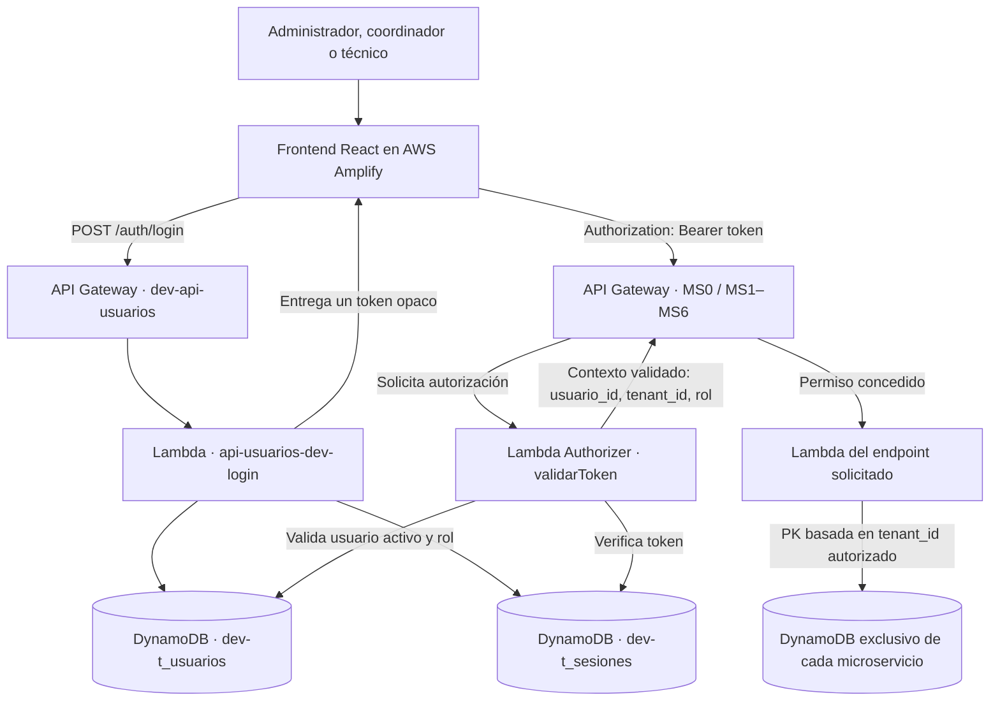
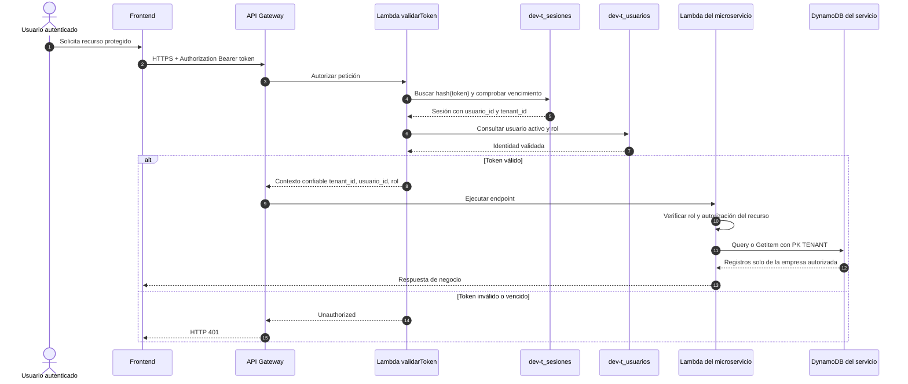
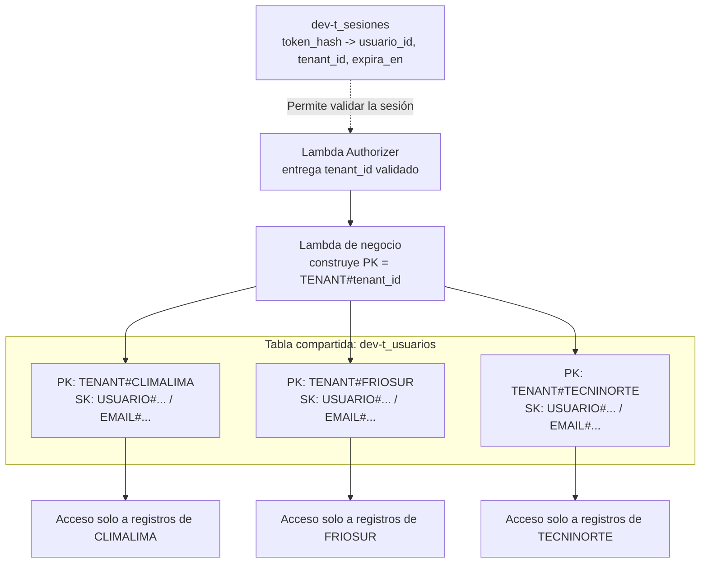
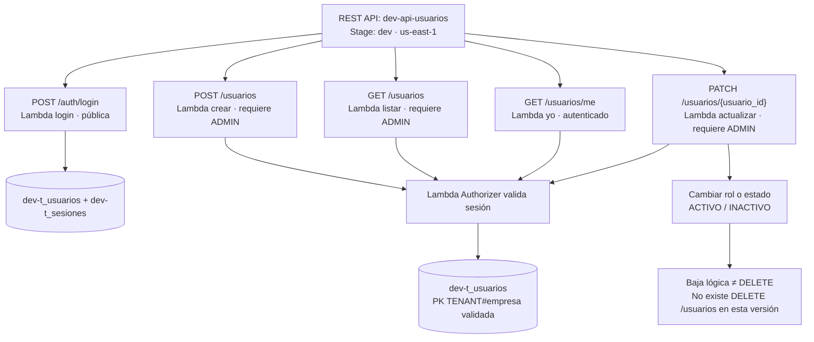
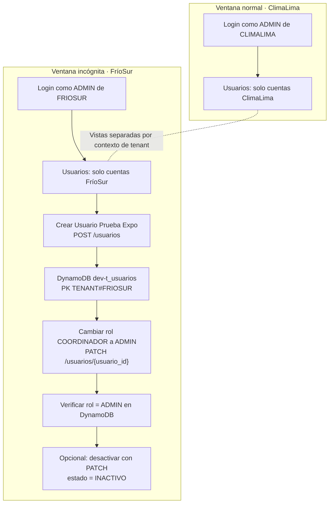

# Trazora FSM — Usuarios y Multi-tenancy

## 01. Arquitectura general · MS0 Usuarios



## 02. Flujo de inicio de sesión

```mermaid
sequenceDiagram
  autonumber
  actor U as Usuario
  participant W as React / Amplify
  participant G as API Gateway Usuarios
  participant L as Lambda login
  participant D as DynamoDB dev-t_usuarios
  participant S as DynamoDB dev-t_sesiones
  U->>W: Selecciona empresa y escribe credenciales
  W->>G: POST /auth/login
  G->>L: tenant_id, email, password
  L->>D: Buscar EMAIL y USUARIO dentro de TENANT#empresa
  D-->>L: Usuario, estado, rol y password_hash
  alt Credenciales correctas y usuario ACTIVO
    L->>L: Comprobar hash y generar token opaco aleatorio
    L->>S: Guardar hash(token), usuario_id, tenant_id y expiración
    S-->>L: Sesión creada
    L-->>G: Token y vencimiento
    G-->>W: HTTP 200
    W-->>U: Acceso autorizado
  else Credenciales incorrectas
    L-->>G: Credenciales inválidas
    G-->>W: HTTP 401
  end
  Note over W,S: El token es opaco; los datos del tenant y rol se resuelven en el backend.
```

## 03. Cómo protege el Authorizer las APIs



## 04. Aislamiento multi-tenant en DynamoDB



## 05. API Gateway y operaciones de Usuarios



## 06. Demostración: dos empresas y actualización real


